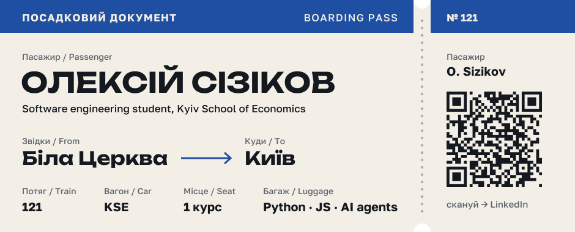

  

Пишу софт, яким живі люди користуються вже наступного тижня: діти в таборі Залізної Зміни, вболівальники «Локомотива», команда, з якою волонтерю. Зараз розбираюсь з AI-агентами, щоб бот сам читав робочі чати й ставив зустрічі в календар, а не я.

   
   
   
   
   
   
  

Номер потяга — кількість комітів у репозиторії. Рядки на табло клікаються. TG-LOKO та Agent-One приватні, код покажу на співбесіді.

  

  <a href="https://www.linkedin.com/in/alex-sizikov-072776346/">LinkedIn</a> ·
  <a href="https://www.instagram.com/ared1211/">Instagram</a> ·
  <a href="https://alexpro121.github.io/loko-rikoshet/">Зіграти в LOKO RUSH</a>

